# Hi, I'm Lenny

**Software developer based in Italy.**

I build practical tools, from command-line utilities to desktop and web applications.
My work spans Go, Python and TypeScript, with an interest in automation and developer tooling.

[Projects](#selected-projects) · [Tech stack](#tech-stack) · [Latest releases](#latest-releases) · [Get in touch](#get-in-touch)

## Selected projects

| Project | Overview | Built with |
| :--- | :--- | :--- |
| [**Caddy Analyzer**](https://github.com/lenny-ts/caddy-analyzer) | Zero-dependency Caddy v2 access-log analyzer with a terminal dashboard, traffic statistics and threat inspection. | Go |
| [**League Profile Tool**](https://github.com/lenny-ts/league_profile_tool) | League of Legends profile customization with real-time LCU sync, custom status management and automatic updates. | TypeScript, React, Tauri v2 |

**Also worth exploring:** [tdl](https://github.com/iyear/tdl) · [Homebutler](https://github.com/Higangssh/homebutler) · [Vela Chess](https://github.com/velachess/velachess)

[Browse all my repositories →](https://github.com/lenny-ts?tab=repositories)

## Tech stack

- **Languages:** Go, Python, TypeScript, JavaScript, Java, C, PHP
- **Web & APIs:** Svelte, Django, FastAPI, Node.js, Tailwind CSS, HTML, CSS
- **Data:** MySQL, Redis, SQLite
- **Tools & platforms:** Git, Docker, Linux, Bash, npm, pnpm

## Latest releases

<!-- DEPLOY_JOURNAL_START -->

| Project | Version | Date | Notes |
|:---|---:|---:|:---|
| [caddy-analyzer](https://github.com/lenny-ts/caddy-analyzer/releases/tag/v0.8.1) | v0.8.1 | 2026-10-19 | `v0.8.1` |
| [league_profile_tool](https://github.com/lenny-ts/league_profile_tool/releases/tag/v2.0.1) | v2.0.1 | 2026-10-11 | `League Profile Tool v2.0.1` |
| [Spotify-Playlist-Reader](https://github.com/lenny-ts/Spotify-Playlist-Reader/releases/tag/1.3) | 1.3 | 2024-09-24 | `1.3` |

<!-- DEPLOY_JOURNAL_END -->

Updated automatically from my repositories' latest releases.

## Behind the code

A little more about me

 

GitHub activity &amp; stats

 

<picture>
  <source media="(prefers-color-scheme: dark)" srcset="https://raw.githubusercontent.com/lenny-ts/lenny-ts/output/github-contribution-grid-snake-dark.svg" />
  
</picture>

  
  

## Get in touch

Open to collaboration and conversations about useful software.

[Discord](https://discordapp.com/users/1001158048276033536) · [Instagram](https://www.instagram.com/lenny.ts_)

---

If you find my projects useful, you can [support my work on Ko-fi](https://ko-fi.com/profumato).
